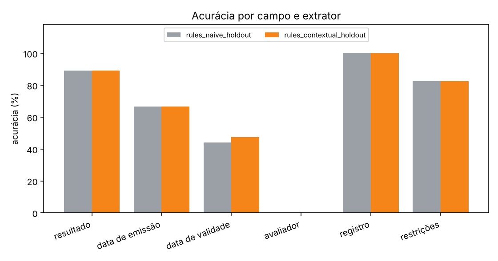

# Comparação de extratores

| extrator | documento exato | IC 95% | resultado correto | falso apto | latência média |
| --- | --- | --- | --- | --- | --- |
| rules_naive_holdout | 0.0% | [0.0; 0.0] | 89.2% | 0/22 | 0.1 ms |
| rules_contextual_holdout | 0.0% | [0.0; 0.0] | 89.2% | 0/22 | 0.2 ms |

## Acurácia por campo

| campo | rules_naive_holdout | rules_contextual_holdout |
| --- | --- | --- |
| resultado | 89.2% | 89.2% |
| data de emissão | 66.7% | 66.7% |
| data de validade | 44.2% | 47.5% |
| avaliador | 0.0% | 0.0% |
| registro | 100.0% | 100.0% |
| restrições | 82.5% | 82.5% |

