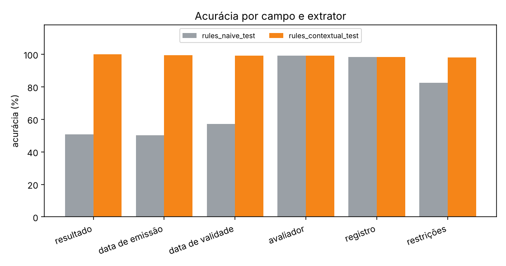

# Comparação de extratores

| extrator | documento exato | IC 95% | resultado correto | falso apto | latência média |
| --- | --- | --- | --- | --- | --- |
| rules_naive_test | 4.7% | [2.5; 7.2] | 50.6% | 21/71 | 0.1 ms |
| rules_contextual_test | 95.3% | [92.8; 97.5] | 100.0% | 0/71 | 0.2 ms |

## Acurácia por campo

| campo | rules_naive_test | rules_contextual_test |
| --- | --- | --- |
| resultado | 50.6% | 100.0% |
| data de emissão | 50.3% | 99.4% |
| data de validade | 57.2% | 99.1% |
| avaliador | 99.1% | 99.1% |
| registro | 98.4% | 98.4% |
| restrições | 82.5% | 98.1% |

