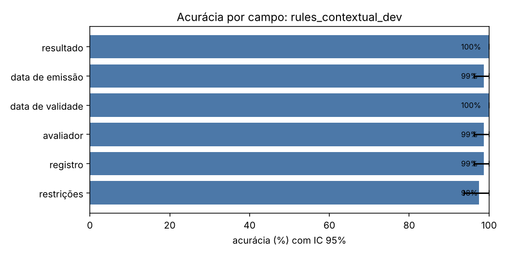
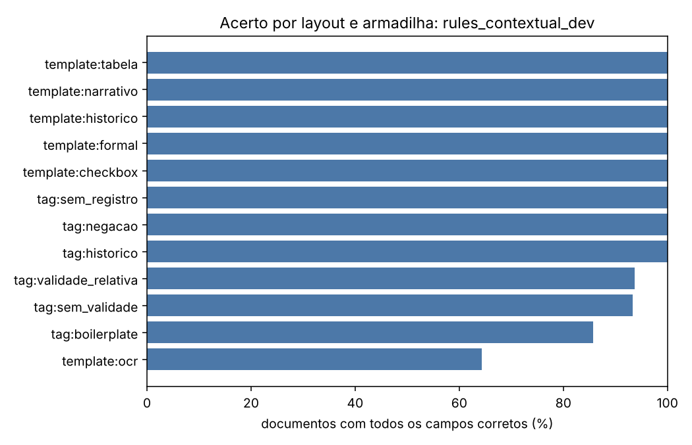
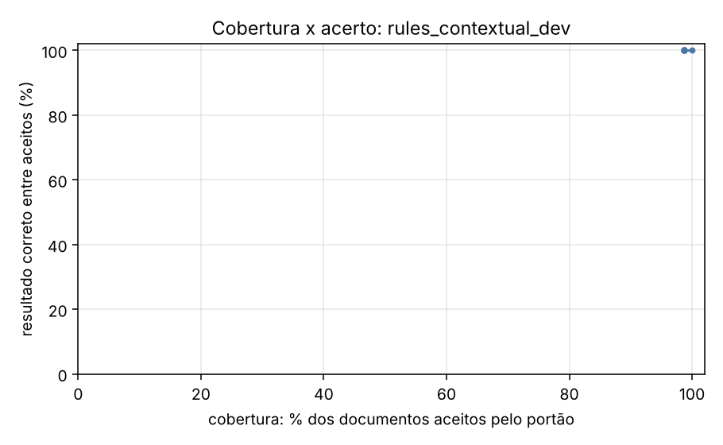

# Relatório de avaliação: rules_contextual_dev

Conjunto: `dev` (80 laudos sintéticos). Os dados são fictícios e gerados por `synth.py`; os números valem para essa distribuição e não preveem o desempenho em laudos reais.

- Documentos avaliados: **80**
- Documentos com todos os campos corretos: **93.8%** (IC 95%: [87.5; 98.8])
- Resultado (apto/inapto/com restrições) correto: **100.0%** (IC 95%: [100.0; 100.0])
- **Falso apto** (laudo inapto lido como apto): 0 de 25 (0.0%)
- Falso inapto (laudo apto lido como inapto): 0 de 55 (0.0%)
- Execuções com erro: 0; documentos sem previsão: 0

O erro mais caro neste problema é o **falso apto**: um laudo inapto liberado como apto.

## Desempenho por campo

| campo | acurácia | IC 95% | precisão | revocação | F1 | alucinação | omissão | valores errados |
| --- | --- | --- | --- | --- | --- | --- | --- | --- |
| resultado | 100.0% | [100.0; 100.0] | 100.0% | 100.0% | 100.0% | — | 0.0% | 0 |
| data de emissão | 98.8% | [96.2; 100.0] | 100.0% | 98.8% | 99.4% | — | 1.2% | 0 |
| data de validade | 100.0% | [100.0; 100.0] | 100.0% | 100.0% | 100.0% | 0.0% | 0.0% | 0 |
| avaliador | 98.8% | [96.2; 100.0] | 98.8% | 98.8% | 98.8% | — | 0.0% | 1 |
| registro | 98.8% | [96.2; 100.0] | 100.0% | 98.7% | 99.4% | 0.0% | 1.3% | 0 |
| restrições | 97.5% | [93.8; 100.0] | 88.9% | 100.0% | 94.1% | 3.1% | 0.0% | 0 |

## Matriz de confusão do resultado

Linhas: gabarito. Colunas: previsto.

| gabarito \ previsto | apto | inapto | apto_com_restricoes | outro |
| --- | --- | --- | --- | --- |
| apto | 39 | 0 | 0 | 0 |
| inapto | 0 | 25 | 0 | 0 |
| apto_com_restricoes | 0 | 0 | 16 | 0 |

## Onde o extrator erra

Acerto do documento inteiro (todos os campos) e do resultado, por layout e por armadilha. Uma armadilha só tem sentido comparada aos outros grupos; os grupos se sobrepõem.

| grupo | n | documento exato | resultado correto |
| --- | --- | --- | --- |
| tag:boilerplate | 7 | 85.7% | 100.0% |
| tag:historico | 2 | 100.0% | 100.0% |
| tag:negacao | 5 | 100.0% | 100.0% |
| tag:sem_registro | 2 | 100.0% | 100.0% |
| tag:sem_validade | 15 | 93.3% | 100.0% |
| tag:validade_relativa | 16 | 93.8% | 100.0% |
| template:checkbox | 13 | 100.0% | 100.0% |
| template:formal | 14 | 100.0% | 100.0% |
| template:historico | 13 | 100.0% | 100.0% |
| template:narrativo | 13 | 100.0% | 100.0% |
| template:ocr | 14 | 64.3% | 100.0% |
| template:tabela | 13 | 100.0% | 100.0% |

## Portão de qualidade

O portão aceita uma extração quando o esquema é válido e o trecho citado como evidência existe no documento com similaridade acima do limiar. A tabela mostra o que passa em cada limiar e quão certo é o resultado entre os aceitos.

| limiar | cobertura (aceitos) | resultado correto entre aceitos | erros que passaram | erros barrados |
| --- | --- | --- | --- | --- |
| 0.00 | 100.0% | 100.0% | 0 | — |
| 0.50 | 98.8% | 100.0% | 0 | — |
| 0.80 | 98.8% | 100.0% | 0 | — |
| 0.90 | 98.8% | 100.0% | 0 | — |
| 0.95 | 98.8% | 100.0% | 0 | — |
| 1.00 | 98.8% | 100.0% | 0 | — |

## Custo e latência

- Tokens de entrada: 0; de saída: 0
- Latência média por documento: 0.2 ms; p95: 0.2 ms
- Custo: não calculado (preencha `pricing.yaml` com os preços do seu deployment)

## Exemplos de erro

| documento | campo | desfecho | gabarito | previsto | layout |
| --- | --- | --- | --- | --- | --- |
| laudo_0035 | data_emissao | omissao | 2023-10-10 | None | ocr |
| laudo_0095 | registro_profissional | omissao | CRP 11/36371 | None | ocr |
| laudo_0155 | restricoes | alucinacao | None | - VÁLIDO ATÉ .... 16-06-2025 | ocr |
| laudo_0185 | avaliador | errado | Isabela Vasconcelos Holanda | ISABELA VASC0NCEL0S HOLANDA | ocr |
| laudo_0215 | restricoes | alucinacao | None | - VALIDADE ...... 6 MESES A PARTIR DA EMISSAO | ocr |
