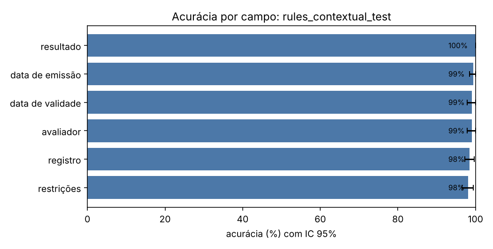
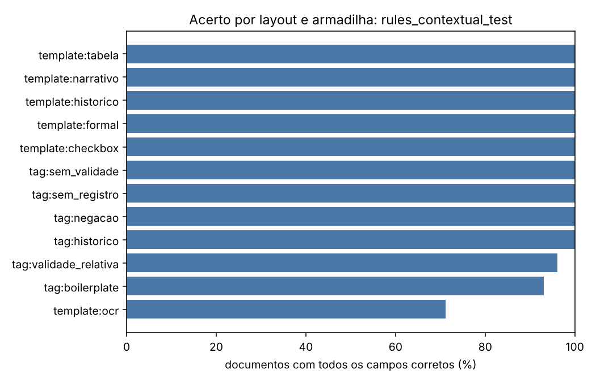
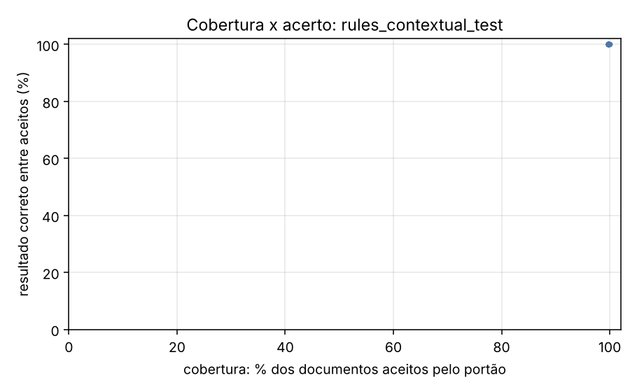

# Relatório de avaliação: rules_contextual_test

Conjunto: `test` (320 laudos sintéticos). Os dados são fictícios e gerados por `synth.py`; os números valem para essa distribuição e não preveem o desempenho em laudos reais.

- Documentos avaliados: **320**
- Documentos com todos os campos corretos: **95.3%** (IC 95%: [92.8; 97.5])
- Resultado (apto/inapto/com restrições) correto: **100.0%** (IC 95%: [100.0; 100.0])
- **Falso apto** (laudo inapto lido como apto): 0 de 71 (0.0%)
- Falso inapto (laudo apto lido como inapto): 0 de 249 (0.0%)
- Execuções com erro: 0; documentos sem previsão: 0

O erro mais caro neste problema é o **falso apto**: um laudo inapto liberado como apto.

## Desempenho por campo

| campo | acurácia | IC 95% | precisão | revocação | F1 | alucinação | omissão | valores errados |
| --- | --- | --- | --- | --- | --- | --- | --- | --- |
| resultado | 100.0% | [100.0; 100.0] | 100.0% | 100.0% | 100.0% | — | 0.0% | 0 |
| data de emissão | 99.4% | [98.4; 100.0] | 99.7% | 99.4% | 99.5% | — | 0.3% | 1 |
| data de validade | 99.1% | [97.8; 100.0] | 99.6% | 98.9% | 99.2% | 0.0% | 0.8% | 1 |
| avaliador | 99.1% | [97.8; 100.0] | 99.1% | 99.1% | 99.1% | — | 0.0% | 3 |
| registro | 98.4% | [97.2; 99.7] | 100.0% | 98.3% | 99.2% | 0.0% | 1.7% | 0 |
| restrições | 98.1% | [96.6; 99.4] | 90.2% | 98.2% | 94.0% | 1.9% | 0.0% | 1 |

## Matriz de confusão do resultado

Linhas: gabarito. Colunas: previsto.

| gabarito \ previsto | apto | inapto | apto_com_restricoes | outro |
| --- | --- | --- | --- | --- |
| apto | 193 | 0 | 0 | 0 |
| inapto | 0 | 71 | 0 | 0 |
| apto_com_restricoes | 0 | 0 | 56 | 0 |

## Onde o extrator erra

Acerto do documento inteiro (todos os campos) e do resultado, por layout e por armadilha. Uma armadilha só tem sentido comparada aos outros grupos; os grupos se sobrepõem.

| grupo | n | documento exato | resultado correto |
| --- | --- | --- | --- |
| tag:boilerplate | 43 | 93.0% | 100.0% |
| tag:historico | 22 | 100.0% | 100.0% |
| tag:negacao | 15 | 100.0% | 100.0% |
| tag:sem_registro | 17 | 100.0% | 100.0% |
| tag:sem_validade | 57 | 100.0% | 100.0% |
| tag:validade_relativa | 78 | 96.2% | 100.0% |
| template:checkbox | 54 | 100.0% | 100.0% |
| template:formal | 53 | 100.0% | 100.0% |
| template:historico | 53 | 100.0% | 100.0% |
| template:narrativo | 54 | 100.0% | 100.0% |
| template:ocr | 52 | 71.2% | 100.0% |
| template:tabela | 54 | 100.0% | 100.0% |

## Portão de qualidade

O portão aceita uma extração quando o esquema é válido e o trecho citado como evidência existe no documento com similaridade acima do limiar. A tabela mostra o que passa em cada limiar e quão certo é o resultado entre os aceitos.

| limiar | cobertura (aceitos) | resultado correto entre aceitos | erros que passaram | erros barrados |
| --- | --- | --- | --- | --- |
| 0.00 | 100.0% | 100.0% | 0 | — |
| 0.50 | 99.7% | 100.0% | 0 | — |
| 0.80 | 99.7% | 100.0% | 0 | — |
| 0.90 | 99.7% | 100.0% | 0 | — |
| 0.95 | 99.7% | 100.0% | 0 | — |
| 1.00 | 99.7% | 100.0% | 0 | — |

## Custo e latência

- Tokens de entrada: 0; de saída: 0
- Latência média por documento: 0.2 ms; p95: 0.3 ms
- Custo: não calculado (preencha `pricing.yaml` com os preços do seu deployment)

## Exemplos de erro

| documento | campo | desfecho | gabarito | previsto | layout |
| --- | --- | --- | --- | --- | --- |
| laudo_0011 | restricoes | errado | restrição ao porte de arma de fogo | RESTRIÇAO AO PORTE DE ARMA DE FOGO VALIDADE: 24 DE MARÇO DE 2024 | ocr |
| laudo_0023 | restricoes | alucinacao | None | - VÁLIDO ATE .... 15/06/2024 | ocr |
| laudo_0053 | data_validade | omissao | 2028-01-07 | None | ocr |
| laudo_0053 | registro_profissional | omissao | CRP 11/28428 | None | ocr |
| laudo_0119 | avaliador | errado | Otávio Nogueira Oliveira | OTAVIO NOGUEIRA 0LIVEIRA | ocr |
| laudo_0119 | restricoes | alucinacao | None | NENHUMA VALIDADE: 21/11/25 | ocr |
| laudo_0203 | data_emissao | errado | 2023-01-15 | 2023-01-05 | ocr |
| laudo_0203 | data_validade | errado | 2024-01-15 | 2024-01-05 | ocr |
| laudo_0209 | avaliador | errado | Patrícia Pinheiro Lima | PATRÍCIA PINHEIR0 LIMA | ocr |
| laudo_0221 | data_emissao | omissao | 2026-07-06 | None | ocr |
| laudo_0239 | registro_profissional | omissao | CRP 11/18509 | None | ocr |
| laudo_0269 | registro_profissional | omissao | CRP 11/12992 | None | ocr |
| laudo_0293 | data_validade | omissao | 2026-06-09 | None | ocr |
| laudo_0317 | restricoes | alucinacao | None | - VALIDO ATÉ ....  02/09/2026 | ocr |
| laudo_0323 | registro_profissional | omissao | CRP 11/16480 | None | ocr |
| laudo_0329 | restricoes | alucinacao | None | NENHUMA VALIDADE: 10/10/2024 | ocr |
| laudo_0341 | avaliador | errado | Nelson Dantas Queiroz | NELS0N DANTAS QUEIROZ | ocr |
| laudo_0359 | registro_profissional | omissao | CRP 11/32558 | None | ocr |
| laudo_0359 | restricoes | alucinacao | None | - VALIDADE  ...... 6 meses a partir da emissao | ocr |
