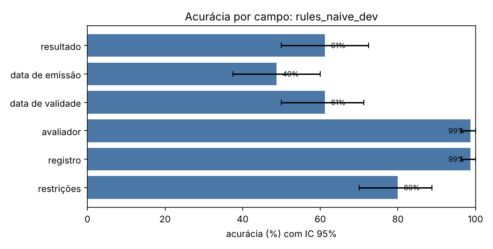
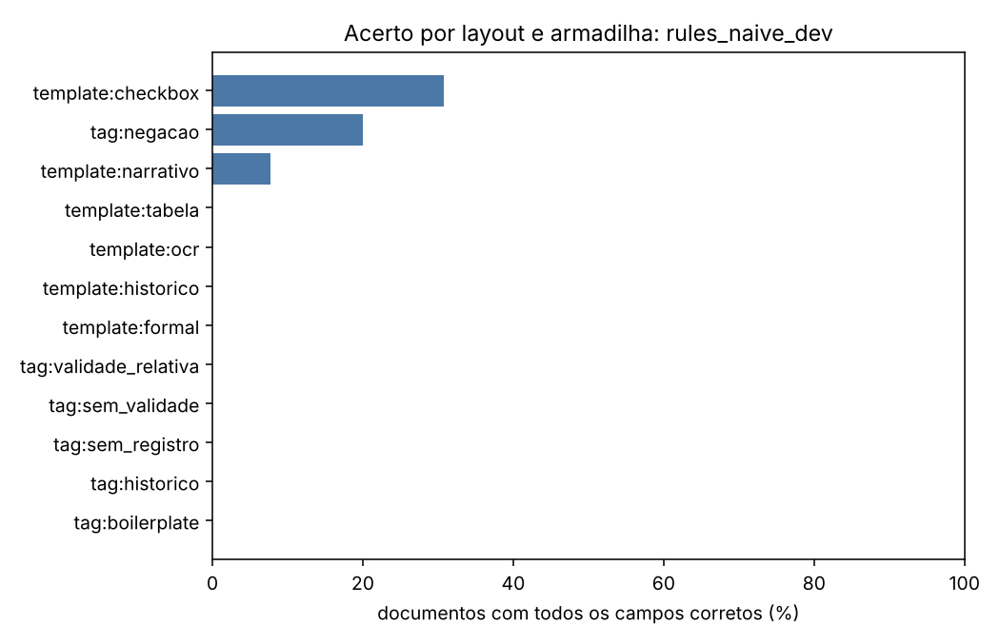
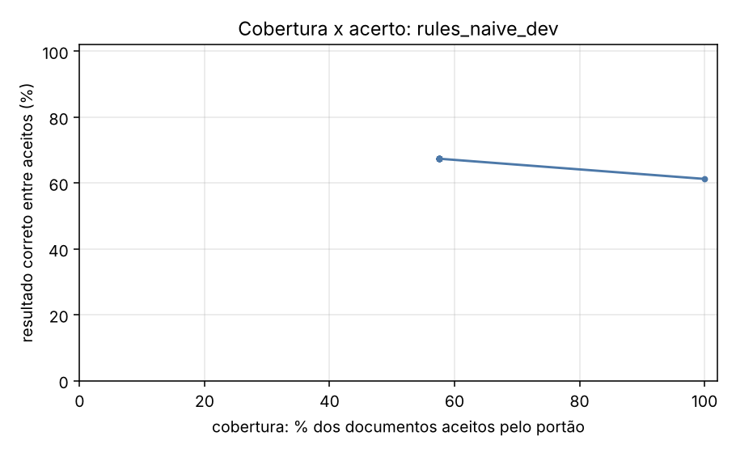

# Relatório de avaliação: rules_naive_dev

Conjunto: `dev` (80 laudos sintéticos). Os dados são fictícios e gerados por `synth.py`; os números valem para essa distribuição e não preveem o desempenho em laudos reais.

- Documentos avaliados: **80**
- Documentos com todos os campos corretos: **6.2%** (IC 95%: [1.2; 11.2])
- Resultado (apto/inapto/com restrições) correto: **61.3%** (IC 95%: [50.0; 72.5])
- **Falso apto** (laudo inapto lido como apto): 4 de 25 (16.0%)
- Falso inapto (laudo apto lido como inapto): 17 de 55 (30.9%)
- Execuções com erro: 0; documentos sem previsão: 0

O erro mais caro neste problema é o **falso apto**: um laudo inapto liberado como apto.

## Desempenho por campo

| campo | acurácia | IC 95% | precisão | revocação | F1 | alucinação | omissão | valores errados |
| --- | --- | --- | --- | --- | --- | --- | --- | --- |
| resultado | 61.3% | [50.0; 72.5] | 61.3% | 61.3% | 61.3% | — | 0.0% | 31 |
| data de emissão | 48.8% | [37.5; 60.0] | 48.8% | 48.8% | 48.8% | — | 0.0% | 41 |
| data de validade | 61.3% | [50.0; 71.2] | 61.3% | 75.4% | 67.6% | 100.0% | 0.0% | 16 |
| avaliador | 98.8% | [96.2; 100.0] | 98.8% | 98.8% | 98.8% | — | 0.0% | 1 |
| registro | 98.8% | [96.2; 100.0] | 100.0% | 98.7% | 99.4% | 0.0% | 1.3% | 0 |
| restrições | 80.0% | [70.0; 88.8] | — | 0.0% | — | 0.0% | 100.0% | 0 |

## Matriz de confusão do resultado

Linhas: gabarito. Colunas: previsto.

| gabarito \ previsto | apto | inapto | apto_com_restricoes | outro |
| --- | --- | --- | --- | --- |
| apto | 19 | 15 | 5 | 0 |
| inapto | 1 | 21 | 3 | 0 |
| apto_com_restricoes | 5 | 2 | 9 | 0 |

## Onde o extrator erra

Acerto do documento inteiro (todos os campos) e do resultado, por layout e por armadilha. Uma armadilha só tem sentido comparada aos outros grupos; os grupos se sobrepõem.

| grupo | n | documento exato | resultado correto |
| --- | --- | --- | --- |
| tag:boilerplate | 7 | 0.0% | 28.6% |
| tag:historico | 2 | 0.0% | 0.0% |
| tag:negacao | 5 | 20.0% | 20.0% |
| tag:sem_registro | 2 | 0.0% | 0.0% |
| tag:sem_validade | 15 | 0.0% | 73.3% |
| tag:validade_relativa | 16 | 0.0% | 56.2% |
| template:checkbox | 13 | 30.8% | 46.2% |
| template:formal | 14 | 0.0% | 78.6% |
| template:historico | 13 | 0.0% | 0.0% |
| template:narrativo | 13 | 7.7% | 53.8% |
| template:ocr | 14 | 0.0% | 85.7% |
| template:tabela | 13 | 0.0% | 100.0% |

## Portão de qualidade

O portão aceita uma extração quando o esquema é válido e o trecho citado como evidência existe no documento com similaridade acima do limiar. A tabela mostra o que passa em cada limiar e quão certo é o resultado entre os aceitos.

| limiar | cobertura (aceitos) | resultado correto entre aceitos | erros que passaram | erros barrados |
| --- | --- | --- | --- | --- |
| 0.00 | 100.0% | 61.3% | 31 | 0.0% |
| 0.50 | 57.5% | 67.4% | 15 | 51.6% |
| 0.80 | 57.5% | 67.4% | 15 | 51.6% |
| 0.90 | 57.5% | 67.4% | 15 | 51.6% |
| 0.95 | 57.5% | 67.4% | 15 | 51.6% |
| 1.00 | 57.5% | 67.4% | 15 | 51.6% |

## Custo e latência

- Tokens de entrada: 0; de saída: 0
- Latência média por documento: 0.1 ms; p95: 0.2 ms
- Custo: não calculado (preencha `pricing.yaml` com os preços do seu deployment)

## Exemplos de erro

| documento | campo | desfecho | gabarito | previsto | layout |
| --- | --- | --- | --- | --- | --- |
| laudo_0000 | data_emissao | errado | 2023-02-22 | 1970-04-08 | formal |
| laudo_0000 | data_validade | alucinacao | None | 2023-02-22 | formal |
| laudo_0005 | data_emissao | errado | 2025-06-10 | 2084-11-17 | ocr |
| laudo_0010 | resultado | errado | apto_com_restricoes | apto | historico |
| laudo_0010 | restricoes | omissao | restrição ao porte de arma de fogo | None | historico |
| laudo_0015 | resultado | errado | apto_com_restricoes | apto | checkbox |
| laudo_0015 | data_validade | errado | 2025-08-06 | 2023-08-01 | checkbox |
| laudo_0015 | restricoes | omissao | necessidade de reavaliação em 6 meses | None | checkbox |
| laudo_0020 | data_emissao | errado | 2026-02-03 | 1996-12-10 | tabela |
| laudo_0025 | data_validade | alucinacao | None | 2025-04-12 | narrativo |
| laudo_0030 | resultado | errado | apto_com_restricoes | inapto | formal |
| laudo_0030 | data_emissao | errado | 2024-11-27 | 1987-12-27 | formal |
| laudo_0030 | restricoes | omissao | uso obrigatório de lentes corretivas | None | formal |
| laudo_0035 | data_emissao | errado | 2023-10-10 | 1973-10-13 | ocr |
| laudo_0040 | resultado | errado | apto_com_restricoes | apto | historico |
| laudo_0040 | restricoes | omissao | necessidade de reavaliação em 6 meses | None | historico |
| laudo_0050 | data_emissao | errado | 2025-05-11 | 2072-03-18 | tabela |
| laudo_0050 | restricoes | omissao | necessidade de reavaliação em 6 meses | None | tabela |
| laudo_0060 | data_emissao | errado | 2023-08-06 | 1990-08-25 | formal |
| laudo_0060 | data_validade | alucinacao | None | 2023-08-06 | formal |
| laudo_0065 | data_emissao | errado | 2025-01-06 | 1996-07-23 | ocr |
| laudo_0065 | data_validade | alucinacao | None | 2025-01-06 | ocr |
| laudo_0070 | resultado | errado | apto | inapto | historico |
| laudo_0070 | data_validade | alucinacao | None | 2025-11-07 | historico |
| laudo_0075 | resultado | errado | apto_com_restricoes | apto | checkbox |
