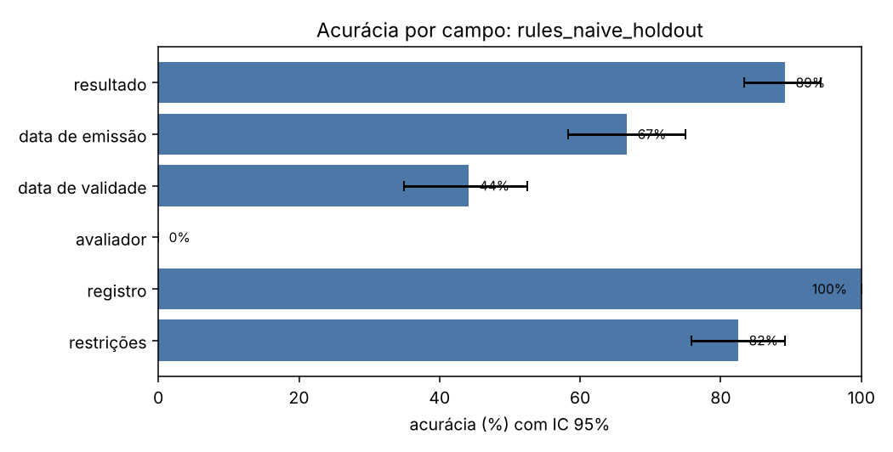
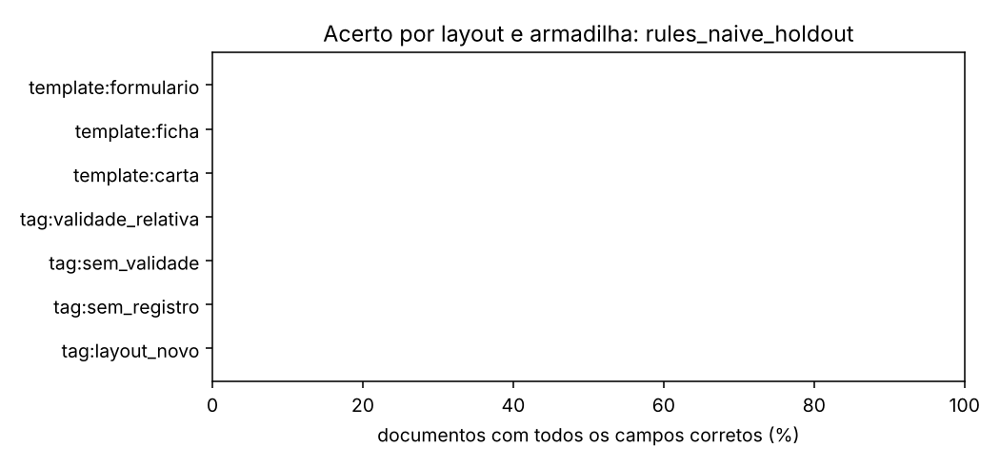
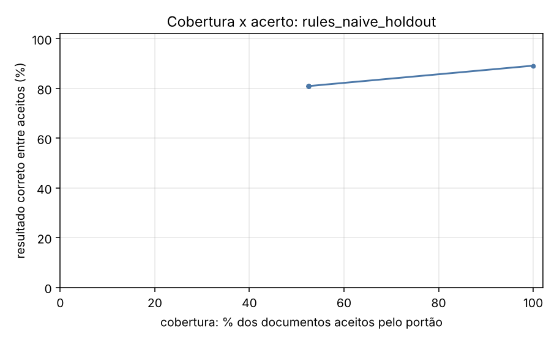

# Relatório de avaliação: rules_naive_holdout

Conjunto: `holdout` (120 laudos sintéticos). Os dados são fictícios e gerados por `synth.py`; os números valem para essa distribuição e não preveem o desempenho em laudos reais.

- Documentos avaliados: **120**
- Documentos com todos os campos corretos: **0.0%** (IC 95%: [0.0; 0.0])
- Resultado (apto/inapto/com restrições) correto: **89.2%** (IC 95%: [83.3; 94.2])
- **Falso apto** (laudo inapto lido como apto): 0 de 22 (0.0%)
- Falso inapto (laudo apto lido como inapto): 0 de 98 (0.0%)
- Execuções com erro: 0; documentos sem previsão: 0

O erro mais caro neste problema é o **falso apto**: um laudo inapto liberado como apto.

## Desempenho por campo

| campo | acurácia | IC 95% | precisão | revocação | F1 | alucinação | omissão | valores errados |
| --- | --- | --- | --- | --- | --- | --- | --- | --- |
| resultado | 89.2% | [83.3; 94.2] | 89.2% | 89.2% | 89.2% | — | 0.0% | 13 |
| data de emissão | 66.7% | [58.3; 75.0] | 66.7% | 66.7% | 66.7% | — | 0.0% | 40 |
| data de validade | 44.2% | [35.0; 52.5] | 44.2% | 52.0% | 47.7% | 100.0% | 0.0% | 49 |
| avaliador | 0.0% | [0.0; 0.0] | — | 0.0% | — | — | 100.0% | 0 |
| registro | 100.0% | [100.0; 100.0] | 100.0% | 100.0% | 100.0% | 0.0% | 0.0% | 0 |
| restrições | 82.5% | [75.8; 89.2] | — | 0.0% | — | 0.0% | 100.0% | 0 |

## Matriz de confusão do resultado

Linhas: gabarito. Colunas: previsto.

| gabarito \ previsto | apto | inapto | apto_com_restricoes | outro |
| --- | --- | --- | --- | --- |
| apto | 77 | 0 | 0 | 0 |
| inapto | 0 | 22 | 0 | 0 |
| apto_com_restricoes | 13 | 0 | 8 | 0 |

## Onde o extrator erra

Acerto do documento inteiro (todos os campos) e do resultado, por layout e por armadilha. Uma armadilha só tem sentido comparada aos outros grupos; os grupos se sobrepõem.

| grupo | n | documento exato | resultado correto |
| --- | --- | --- | --- |
| tag:layout_novo | 120 | 0.0% | 89.2% |
| tag:sem_registro | 11 | 0.0% | 90.9% |
| tag:sem_validade | 18 | 0.0% | 100.0% |
| tag:validade_relativa | 49 | 0.0% | 89.8% |
| template:carta | 40 | 0.0% | 85.0% |
| template:ficha | 40 | 0.0% | 100.0% |
| template:formulario | 40 | 0.0% | 82.5% |

## Portão de qualidade

O portão aceita uma extração quando o esquema é válido e o trecho citado como evidência existe no documento com similaridade acima do limiar. A tabela mostra o que passa em cada limiar e quão certo é o resultado entre os aceitos.

| limiar | cobertura (aceitos) | resultado correto entre aceitos | erros que passaram | erros barrados |
| --- | --- | --- | --- | --- |
| 0.00 | 100.0% | 89.2% | 13 | 0.0% |
| 0.50 | 52.5% | 81.0% | 12 | 7.7% |
| 0.80 | 52.5% | 81.0% | 12 | 7.7% |
| 0.90 | 52.5% | 81.0% | 12 | 7.7% |
| 0.95 | 52.5% | 81.0% | 12 | 7.7% |
| 1.00 | 52.5% | 81.0% | 12 | 7.7% |

## Custo e latência

- Tokens de entrada: 0; de saída: 0
- Latência média por documento: 0.1 ms; p95: 0.2 ms
- Custo: não calculado (preencha `pricing.yaml` com os preços do seu deployment)

## Exemplos de erro

| documento | campo | desfecho | gabarito | previsto | layout |
| --- | --- | --- | --- | --- | --- |
| laudo_h0000 | data_emissao | errado | 2023-10-23 | 2000-07-13 | formulario |
| laudo_h0000 | avaliador | omissao | Natália Sampaio Almeida | None | formulario |
| laudo_h0001 | avaliador | omissao | Fábio Vasconcelos Barros | None | carta |
| laudo_h0002 | data_validade | errado | 2027-12-20 | 2025-12-14 | ficha |
| laudo_h0002 | avaliador | omissao | Isabela Barros Vasconcelos | None | ficha |
| laudo_h0003 | resultado | errado | apto_com_restricoes | apto | formulario |
| laudo_h0003 | data_emissao | errado | 2026-05-18 | 1992-08-19 | formulario |
| laudo_h0003 | avaliador | omissao | Daniela Vasconcelos Macedo | None | formulario |
| laudo_h0003 | restricoes | omissao | restrição ao trabalho em turno noturno | None | formulario |
| laudo_h0004 | resultado | errado | apto_com_restricoes | apto | carta |
| laudo_h0004 | avaliador | omissao | Carlos Nogueira Pinheiro | None | carta |
| laudo_h0004 | restricoes | omissao | necessidade de reavaliação em 6 meses | None | carta |
| laudo_h0005 | data_validade | errado | 2025-06-12 | 2024-12-10 | ficha |
| laudo_h0005 | avaliador | omissao | Helena Guedes Barros | None | ficha |
| laudo_h0006 | data_emissao | errado | 2026-06-10 | 1971-12-08 | formulario |
| laudo_h0006 | data_validade | errado | 2026-12-10 | 2026-06-10 | formulario |
| laudo_h0006 | avaliador | omissao | Eduardo Rocha Pinheiro | None | formulario |
| laudo_h0007 | data_validade | errado | 2025-10-03 | 2024-09-30 | carta |
| laudo_h0007 | avaliador | omissao | Beatriz Guedes Holanda | None | carta |
| laudo_h0008 | avaliador | omissao | Thiago Rocha Macedo | None | ficha |
| laudo_h0008 | restricoes | omissao | necessidade de reavaliação em 6 meses | None | ficha |
| laudo_h0009 | data_emissao | errado | 2024-04-19 | 1986-08-15 | formulario |
| laudo_h0009 | data_validade | errado | 2025-04-19 | 2024-04-19 | formulario |
| laudo_h0009 | avaliador | omissao | Natália Sampaio Rocha | None | formulario |
| laudo_h0010 | avaliador | omissao | Larissa Rocha Farias | None | carta |
