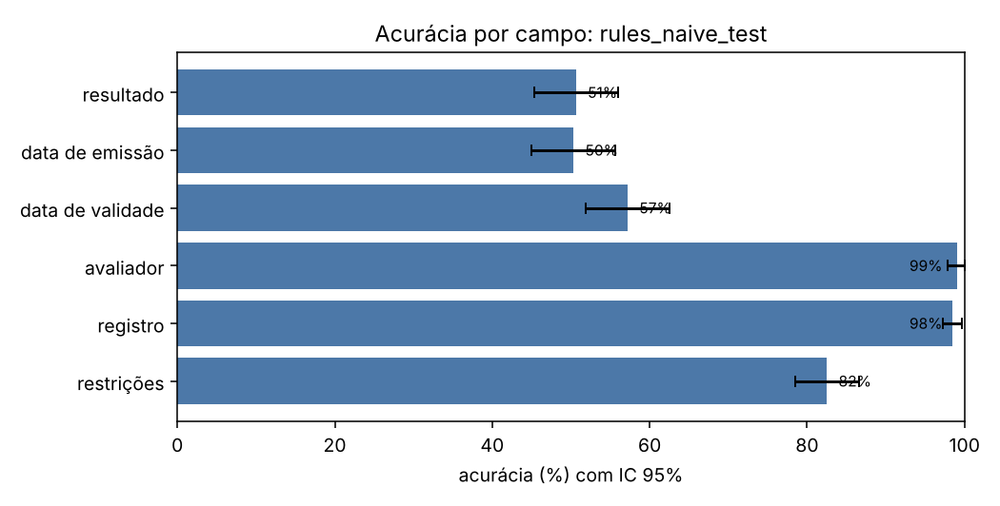
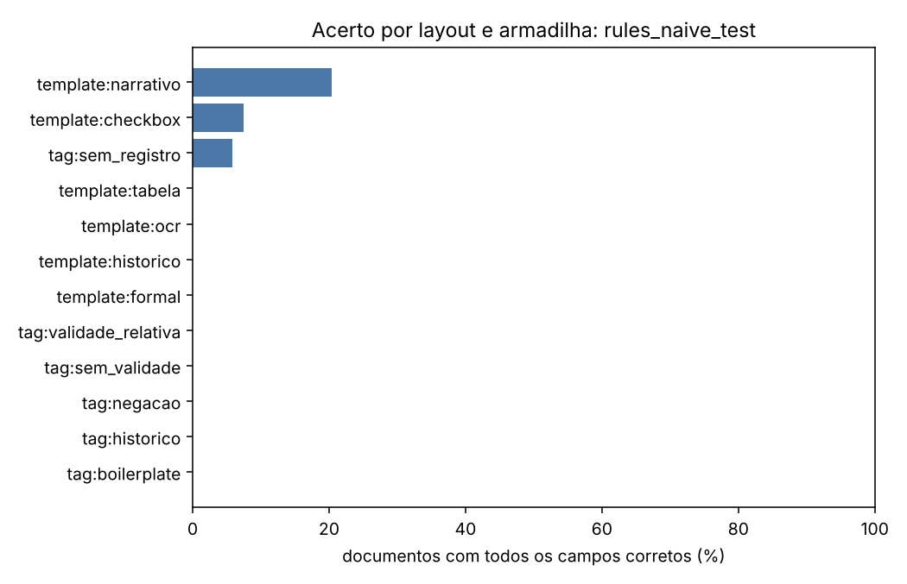
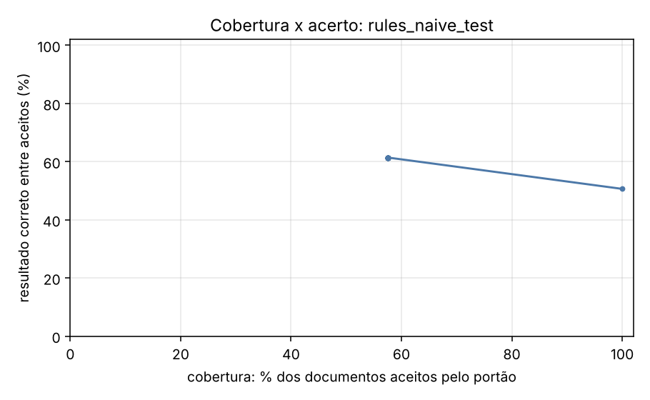

# Relatório de avaliação: rules_naive_test

Conjunto: `test` (320 laudos sintéticos). Os dados são fictícios e gerados por `synth.py`; os números valem para essa distribuição e não preveem o desempenho em laudos reais.

- Documentos avaliados: **320**
- Documentos com todos os campos corretos: **4.7%** (IC 95%: [2.5; 7.2])
- Resultado (apto/inapto/com restrições) correto: **50.6%** (IC 95%: [45.3; 55.9])
- **Falso apto** (laudo inapto lido como apto): 21 de 71 (29.6%)
- Falso inapto (laudo apto lido como inapto): 92 de 249 (36.9%)
- Execuções com erro: 0; documentos sem previsão: 0

O erro mais caro neste problema é o **falso apto**: um laudo inapto liberado como apto.

## Desempenho por campo

| campo | acurácia | IC 95% | precisão | revocação | F1 | alucinação | omissão | valores errados |
| --- | --- | --- | --- | --- | --- | --- | --- | --- |
| resultado | 50.6% | [45.3; 55.9] | 50.6% | 50.6% | 50.6% | — | 0.0% | 158 |
| data de emissão | 50.3% | [45.0; 55.6] | 50.3% | 50.3% | 50.3% | — | 0.0% | 159 |
| data de validade | 57.2% | [51.9; 62.5] | 57.2% | 69.6% | 62.8% | 100.0% | 0.0% | 80 |
| avaliador | 99.1% | [97.8; 100.0] | 99.1% | 99.1% | 99.1% | — | 0.0% | 3 |
| registro | 98.4% | [97.2; 99.7] | 100.0% | 98.3% | 99.2% | 0.0% | 1.7% | 0 |
| restrições | 82.5% | [78.4; 86.6] | — | 0.0% | — | 0.0% | 100.0% | 0 |

## Matriz de confusão do resultado

Linhas: gabarito. Colunas: previsto.

| gabarito \ previsto | apto | inapto | apto_com_restricoes | outro |
| --- | --- | --- | --- | --- |
| apto | 87 | 70 | 36 | 0 |
| inapto | 12 | 50 | 9 | 0 |
| apto_com_restricoes | 9 | 22 | 25 | 0 |

## Onde o extrator erra

Acerto do documento inteiro (todos os campos) e do resultado, por layout e por armadilha. Uma armadilha só tem sentido comparada aos outros grupos; os grupos se sobrepõem.

| grupo | n | documento exato | resultado correto |
| --- | --- | --- | --- |
| tag:boilerplate | 43 | 0.0% | 23.3% |
| tag:historico | 22 | 0.0% | 0.0% |
| tag:negacao | 15 | 0.0% | 13.3% |
| tag:sem_registro | 17 | 5.9% | 58.8% |
| tag:sem_validade | 57 | 0.0% | 57.9% |
| tag:validade_relativa | 78 | 0.0% | 42.3% |
| template:checkbox | 54 | 7.4% | 22.2% |
| template:formal | 53 | 0.0% | 81.1% |
| template:historico | 53 | 0.0% | 0.0% |
| template:narrativo | 54 | 20.4% | 44.4% |
| template:ocr | 52 | 0.0% | 86.5% |
| template:tabela | 54 | 0.0% | 70.4% |

## Portão de qualidade

O portão aceita uma extração quando o esquema é válido e o trecho citado como evidência existe no documento com similaridade acima do limiar. A tabela mostra o que passa em cada limiar e quão certo é o resultado entre os aceitos.

| limiar | cobertura (aceitos) | resultado correto entre aceitos | erros que passaram | erros barrados |
| --- | --- | --- | --- | --- |
| 0.00 | 100.0% | 50.6% | 158 | 0.0% |
| 0.50 | 57.5% | 61.4% | 71 | 55.1% |
| 0.80 | 57.5% | 61.4% | 71 | 55.1% |
| 0.90 | 57.5% | 61.4% | 71 | 55.1% |
| 0.95 | 57.5% | 61.4% | 71 | 55.1% |
| 1.00 | 57.5% | 61.4% | 71 | 55.1% |

## Custo e latência

- Tokens de entrada: 0; de saída: 0
- Latência média por documento: 0.1 ms; p95: 0.2 ms
- Custo: não calculado (preencha `pricing.yaml` com os preços do seu deployment)

## Exemplos de erro

| documento | campo | desfecho | gabarito | previsto | layout |
| --- | --- | --- | --- | --- | --- |
| laudo_0002 | resultado | errado | apto | inapto | tabela |
| laudo_0002 | data_emissao | errado | 2023-05-24 | 1988-03-12 | tabela |
| laudo_0003 | resultado | errado | apto_com_restricoes | apto | checkbox |
| laudo_0003 | restricoes | omissao | uso obrigatório de lentes corretivas | None | checkbox |
| laudo_0004 | resultado | errado | apto | apto_com_restricoes | historico |
| laudo_0006 | data_emissao | errado | 2025-03-11 | 1978-01-19 | formal |
| laudo_0006 | data_validade | errado | 2026-03-11 | 2025-03-11 | formal |
| laudo_0007 | resultado | errado | apto_com_restricoes | inapto | narrativo |
| laudo_0007 | data_validade | alucinacao | None | 2023-06-10 | narrativo |
| laudo_0007 | restricoes | omissao | restrição ao trabalho em turno noturno | None | narrativo |
| laudo_0008 | data_emissao | errado | 2024-09-07 | 1978-09-09 | tabela |
| laudo_0009 | restricoes | omissao | uso obrigatório de lentes corretivas | None | checkbox |
| laudo_0011 | data_emissao | errado | 2023-03-24 | 1976-07-01 | ocr |
| laudo_0011 | restricoes | omissao | restrição ao porte de arma de fogo | None | ocr |
| laudo_0012 | data_emissao | errado | 2026-03-02 | 1985-04-15 | formal |
| laudo_0013 | resultado | errado | apto | inapto | narrativo |
| laudo_0013 | data_validade | errado | 2025-12-18 | 2024-12-16 | narrativo |
| laudo_0014 | data_emissao | errado | 2024-10-01 | 2003-02-26 | tabela |
| laudo_0016 | resultado | errado | apto_com_restricoes | inapto | historico |
| laudo_0016 | data_validade | errado | 2026-01-09 | 2024-01-07 | historico |
| laudo_0016 | restricoes | omissao | restrição a postos de contato direto com o público | None | historico |
| laudo_0017 | data_emissao | errado | 2024-09-20 | 2082-05-09 | ocr |
| laudo_0017 | data_validade | alucinacao | None | 2024-09-20 | ocr |
| laudo_0018 | data_emissao | errado | 2023-07-07 | 1996-05-22 | formal |
| laudo_0018 | data_validade | alucinacao | None | 2023-07-07 | formal |
